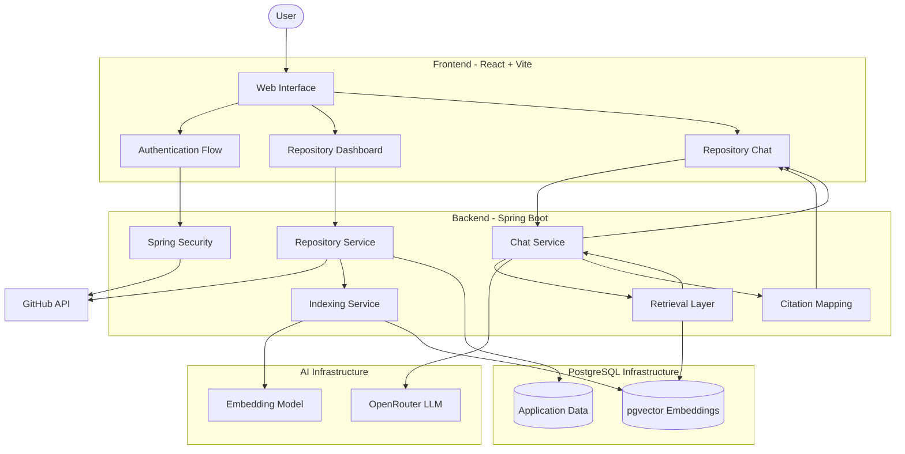
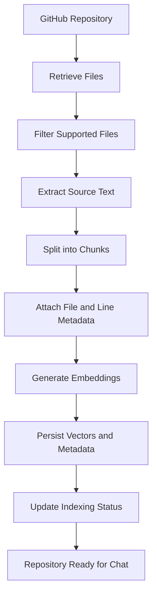
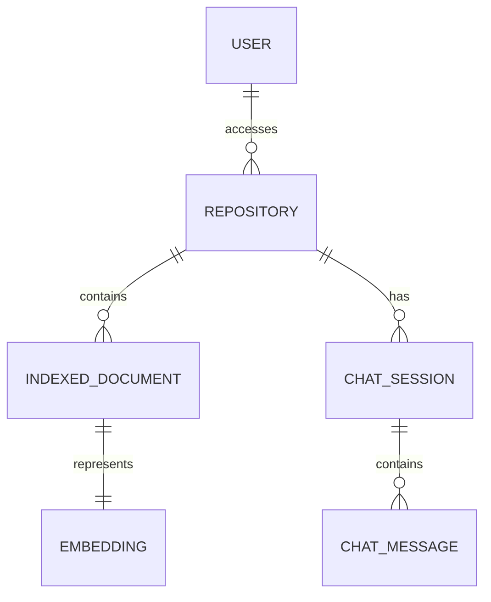

# CodeOrbit 🚀

### AI-Powered GitHub Repository Assistant

**Understand your codebase. Explore your architecture. Ask questions. Get answers grounded in your source code.**

CodeOrbit is an AI-powered GitHub repository assistant that helps developers understand unfamiliar codebases through natural-language conversations. By combining GitHub integration, repository indexing, vector embeddings, semantic search, and Large Language Models (LLMs), CodeOrbit enables developers to ask questions about their repositories and receive contextual answers grounded in relevant source code.

Instead of manually navigating hundreds of files, developers can connect a repository, index its contents, and interact with an AI assistant that retrieves relevant code before generating responses.

CodeOrbit is designed around Retrieval-Augmented Generation (RAG), enabling the assistant to use repository-specific context rather than relying solely on the general knowledge of an LLM.

---

## 📑 Table of Contents

* [Overview](#-overview)
* [The Problem](#-the-problem)
* [Key Features](#-key-features)
* [Example Use Cases](#-example-use-cases)
* [Technology Stack](#-technology-stack)
* [System Architecture](#-system-architecture)
* [Application Architecture](#-application-architecture)
* [Core Services](#-core-services)
* [Complete Application Workflow](#-complete-application-workflow)
* [Repository Indexing Pipeline](#-repository-indexing-pipeline)
* [RAG Pipeline](#-retrieval-augmented-generation-rag-pipeline)
* [Chat and Conversation Workflow](#-chat-and-conversation-workflow)
* [GitHub Integration and Authentication](#-github-integration-and-authentication)
* [Database Architecture](#-database-architecture)
* [Citation and Source Attribution](#-citation-and-source-attribution)
* [Frontend Architecture](#-frontend-architecture)
* [Backend Architecture](#-backend-architecture)
* [Project Structure](#-project-structure)
* [Getting Started](#-getting-started)
* [Environment Configuration](#-environment-configuration)
* [Running the Application](#-running-the-application)
* [Docker and Database Setup](#-docker-and-database-setup)
* [Deployment Architecture](#-deployment-architecture)
* [Security Considerations](#-security-considerations)
* [Error Handling and Reliability](#-error-handling-and-reliability)
* [Performance Considerations](#-performance-considerations)
* [Testing and Verification](#-testing-and-verification)
* [Troubleshooting](#-troubleshooting)
* [Limitations](#-limitations)
* [Future Roadmap](#-future-roadmap)
* [Contributing](#-contributing)
* [License](#-license)

---

## 🌟 Overview

CodeOrbit provides an interactive interface for understanding GitHub repositories using AI.

Developers frequently work with codebases that contain multiple packages, classes, services, controllers, configuration files, and dependencies. Understanding how these components interact can require significant time and effort.

CodeOrbit addresses this problem by combining repository-level code retrieval with conversational AI.

### How it works

1. A user authenticates through GitHub OAuth.
2. The user connects an accessible GitHub repository.
3. CodeOrbit processes and indexes the repository's source files.
4. The indexing pipeline generates vector embeddings for code chunks.
5. Embeddings and associated metadata are stored in PostgreSQL with pgvector.
6. The user opens a repository-specific chat.
7. When a question is submitted, CodeOrbit retrieves relevant code using semantic similarity search.
8. The retrieved context is supplied to an LLM through OpenRouter.
9. The model generates a context-aware response.
10. Source metadata can be used to associate the response with relevant files and line ranges.

### Project objectives

* Simplify repository exploration.
* Reduce the time required to understand unfamiliar projects.
* Make source-code discovery more intuitive.
* Provide repository-specific AI assistance.
* Support traceable answers through source citations.
* Demonstrate the integration of modern backend engineering and AI technologies.

---

## 🎯 The Problem

Understanding an existing codebase is one of the most time-consuming parts of software development.

Developers often need to answer questions such as:

* Where is authentication implemented?
* Which service handles repository indexing?
* How does a request travel from the controller to the database?
* Where is a particular API endpoint defined?
* Which classes are responsible for generating embeddings?
* How are chat messages stored and retrieved?
* Which configuration controls the database connection?
* How does one component interact with another?

Traditional approaches require manually searching files, following method calls, examining dependencies, and reading documentation.

General-purpose AI assistants can help, but they may lack access to the latest version of a particular repository or may produce answers unsupported by its actual implementation.

### The CodeOrbit approach

CodeOrbit combines three capabilities:

**1. Repository understanding**

Repository files are processed into searchable units of source code.

**2. Semantic retrieval**

The system searches for code relevant to the user's question instead of sending the entire repository to the LLM.

**3. Context-grounded generation**

The retrieved code is provided to the model as supporting context, helping it produce answers specific to the selected repository.

This architecture follows the Retrieval-Augmented Generation pattern.

---

## ✨ Key Features

### 1. GitHub Authentication

CodeOrbit integrates GitHub OAuth through Spring Security.

Authenticated users can access the application through the configured authentication flow. Repository access depends on the permissions granted to the application and the authenticated GitHub account.

### 2. Repository Integration

Users can connect a GitHub repository by providing its repository URL.

The application can then associate the repository with its internal repository record and prepare it for indexing.

Repository visibility and access depend on GitHub permissions. Private repository support requires the appropriate OAuth authorization and backend access implementation.

### 3. Repository Indexing

The indexing pipeline prepares source code for semantic retrieval.

Its responsibilities include:

* Identifying files to process.
* Extracting file contents.
* Dividing source code into chunks.
* Generating embeddings.
* Attaching metadata to chunks.
* Persisting vectors and associated information.
* Tracking indexing status.

### 4. AI-Powered Code Chat

Users can ask natural-language questions about an indexed repository.

Examples:

* "Explain the authentication flow."
* "Where is the database connection configured?"
* "How does repository indexing work?"
* "Which classes are involved in generating embeddings?"
* "Explain how this controller communicates with the service layer."

The answer is generated using retrieved repository context and an LLM.

### 5. Semantic Code Search

CodeOrbit uses vector embeddings to identify code chunks that are semantically relevant to a query.

This makes it possible to retrieve relevant code even when the user's wording differs from the identifiers used in the implementation.

### 6. Source Citations

Retrieved documents contain metadata that can identify the original source file and line range.

The citation-mapping layer uses fields such as:

* `filePath`
* `startLine`
* `endLine`
* `language`

These fields can be mapped into citation DTOs and used by the chat interface to identify supporting source code.

Citation quality depends on accurate metadata propagation throughout the indexing and retrieval pipeline.

### 7. Repository-Specific Chat Sessions

The application includes repository-specific chat functionality and chat-session management.

This allows conversations to be associated with a repository rather than treating every question as an unrelated, global conversation.

### 8. Streaming AI Responses

The frontend and backend are designed to support streaming AI responses.

Streaming allows a response to be delivered incrementally rather than requiring the user to wait for the complete answer.

The precise transport and event format depend on the configured chat implementation.

### 9. Modern Web Interface

The frontend uses React, Vite, Tailwind CSS, and reusable UI components to provide the application interface.

The application includes a landing page, authentication flow, dashboard, repository workflow, and repository chat experience.

### 10. Containerized Database Infrastructure

PostgreSQL and pgvector can be run using Docker.

This provides a reproducible database environment for local development and simplifies infrastructure management.

---

## 💡 Example Use Cases

### Understanding an unfamiliar project

**Question:**

"Explain the overall architecture of this repository."

CodeOrbit retrieves relevant architectural components, configuration files, and application entry points before generating an explanation.

### Finding an implementation

**Question:**

"Where is GitHub OAuth configured?"

The system can retrieve configuration classes and related security code that match the question.

### Tracing a request

**Question:**

"Explain how a chat message reaches the AI model."

The assistant can retrieve relevant controllers, services, and model-integration code to explain the request flow.

### Understanding database integration

**Question:**

"How does the application store embeddings?"

The system can retrieve the relevant repository, persistence, entity, and vector-store configuration code.

### Learning a codebase

Developers can ask follow-up questions to explore a repository progressively instead of manually reading every file.

**Important:** The quality of these answers depends on which files have been indexed, the relevance of retrieved chunks, the model's behavior, and the completeness of the source context.

---

## 🛠 Technology Stack

| Layer                       | Technology                               | Responsibility                                         |
| --------------------------- | ---------------------------------------- | ------------------------------------------------------ |
| Frontend framework          | React                                    | Component-based user interface                         |
| Frontend tooling            | Vite                                     | Development server and production builds               |
| Language                    | JavaScript                               | Frontend application logic                             |
| Styling                     | Tailwind CSS v4                          | Utility-based styling                                  |
| UI components               | shadcn/ui with Base UI                   | Reusable interface components                          |
| Backend language            | Java                                     | Application and business logic                         |
| Backend framework           | Spring Boot                              | Application configuration and REST services            |
| Web layer                   | Spring MVC / configured Spring web stack | HTTP request handling                                  |
| Authentication              | Spring Security                          | Security configuration and OAuth integration           |
| Identity provider           | GitHub OAuth                             | User authentication and authorized GitHub access       |
| Persistence                 | Spring Data JPA                          | Database persistence abstraction                       |
| ORM                         | Hibernate                                | Object-relational mapping                              |
| Primary database            | PostgreSQL                               | Relational application data                            |
| Vector database capability  | pgvector                                 | Vector storage and similarity search                   |
| AI integration              | Spring AI                                | Integration with supported AI models and vector stores |
| LLM gateway                 | OpenRouter                               | Access to supported language models                    |
| Embedding model             | `openai/text-embedding-3-small`          | Vector representation of text and code                 |
| Containerization            | Docker                                   | Containerized application and infrastructure           |
| Multi-container development | Docker Compose                           | Local service orchestration                            |
| Frontend hosting            | Vercel                                   | Frontend deployment                                    |
| Backend hosting             | Render                                   | Backend deployment                                     |
| Version control             | Git                                      | Source-code versioning                                 |
| Source hosting              | GitHub                                   | Repository hosting and collaboration                   |

### Why this stack?

**React + Vite**

Provides a modern, modular frontend with a fast development workflow.

**Spring Boot**

Provides a structured backend architecture for business logic, authentication, persistence, and external integrations.

**Spring AI**

Provides abstractions for integrating language models, embedding models, vector stores, and retrieval workflows.

**PostgreSQL + pgvector**

Allows relational application data and vector-search capabilities to coexist within PostgreSQL infrastructure.

**OpenRouter**

Provides a unified API gateway for accessing supported language models.

**Docker**

Makes local database setup and infrastructure configuration easier to reproduce.

---

## 🏗 System Architecture

The following diagram describes the intended high-level architecture.



**Note:** This diagram represents logical responsibilities, not a claim that every box corresponds to a separate deployed service or independently implemented Java class.

CodeOrbit is primarily a web application with integrated backend services. The indexing, retrieval, and chat responsibilities may run within the same Spring Boot application.

### Architecture principles

* Keep UI responsibilities separate from backend business logic.
* Centralize authentication and authorization.
* Separate repository management from indexing logic.
* Use vector retrieval to provide relevant context to the LLM.
* Preserve metadata required for source attribution.
* Keep database persistence behind appropriate application abstractions.
* Make configuration environment-dependent rather than hard-coded.

---

## 🧩 Application Architecture

CodeOrbit can be understood through four architectural layers.

### 1. Presentation Layer

Responsible for:

* Rendering pages and components.
* Handling user interactions.
* Managing loading, success, and error states.
* Displaying repository information.
* Submitting questions.
* Rendering AI responses and citations.

**Technology:** React, JavaScript, Vite, Tailwind CSS.

### 2. Application and Business Layer

Responsible for:

* Repository lifecycle management.
* Indexing orchestration.
* Chat-session management.
* Query processing.
* Retrieval orchestration.
* AI model integration.
* Citation mapping.

**Technology:** Java, Spring Boot, Spring AI.

### 3. Persistence Layer

Responsible for storing application records and searchable vectors.

**Technology:** Spring Data JPA, Hibernate, PostgreSQL, pgvector.

### 4. External Integration Layer

Responsible for communicating with external services.

Integrations include:

* GitHub APIs.
* GitHub OAuth.
* OpenRouter.
* The configured embedding provider.

Keeping these concerns separate makes the application easier to maintain and extend.

---

## ⚙️ Core Services

This section describes the main logical services within CodeOrbit.

These are responsibility boundaries. The actual class names and deployment boundaries depend on the current implementation.

### 1. Authentication and Security

**Purpose:** Authenticate users and protect application resources.

Responsibilities:

* Configure GitHub OAuth login.
* Handle authentication callbacks.
* Establish the application's authenticated session.
* Apply security rules to backend endpoints.
* Enforce access checks for protected resources.
* Coordinate session and cookie behavior.

**Primary technology:** Spring Security and GitHub OAuth.

**Typical flow:**

```text
User
  |
  v
Frontend Login
  |
  v
Backend OAuth Authorization
  |
  v
GitHub Authorization
  |
  v
OAuth Callback
  |
  v
Authenticated Application Session
  |
  v
Protected Application Resources
```

Authentication proves who the user is. Authorization determines which repositories and application resources the user is allowed to access.

These are separate concerns and should be implemented separately.

### 2. Repository Management

**Purpose:** Manage repositories connected to the application.

Responsibilities:

* Accept repository references.
* Validate repository URLs.
* Resolve repository identity.
* Verify access where supported.
* Maintain repository records.
* Expose repository status to the frontend.
* Associate repositories with indexing and chat workflows.

A repository's internal ID can be used to identify it across application routes.

For example:

```text
/chat/{repo.id}
```

This route identifies the repository whose context should be used for the conversation.

**Important:** A repository identifier is not an authorization mechanism. Every protected request must verify that the current user has permission to access that repository.

### 3. Repository Indexing

**Purpose:** Transform repository files into searchable vector documents.

Responsibilities:

* Retrieve or read repository files.
* Filter files according to indexing rules.
* Extract file contents.
* Split files into chunks.
* Attach metadata.
* Generate embeddings.
* Store vectors.
* Track indexing progress and completion status.

Typical indexing states may include:

```text
PENDING
   |
   v
INDEXING
   |
   v
READY
```

A failure state should also be represented in the implementation so that failed indexing attempts can be reported and retried appropriately.

The exact state names should match the project's actual enum or persistence model.

### 4. Embedding Integration

**Purpose:** Convert text and code into numerical vectors.

CodeOrbit is configured to use:

`openai/text-embedding-3-small`

through its AI integration.

The embedding component processes code chunks during indexing and the user's question during retrieval.

For semantic search to work correctly, the query embeddings and indexed document embeddings must use compatible vector dimensions and the same embedding space.

The configured embedding dimension is 1536.

### 5. Vector Retrieval

**Purpose:** Retrieve source-code chunks relevant to a user's question.

Responsibilities:

* Receive the query representation.
* Search the indexed vectors.
* Apply repository-specific filtering.
* Rank or select relevant chunks.
* Return the associated text and metadata.

The retrieval layer should restrict results to the repository selected for the current conversation.

This is important because the database may contain vectors from many repositories.

### 6. Chat and LLM Integration

**Purpose:** Generate repository-aware answers.

Responsibilities:

* Accept user questions.
* Resolve the selected repository and chat session.
* Retrieve relevant code context.
* Construct the model input.
* Invoke the configured LLM through OpenRouter.
* Return the generated response.
* Preserve source metadata for citations.
* Support streaming where configured.

The default model configuration has used the OpenRouter free-model route, while other compatible models can be configured.

Model availability, rate limits, and behavior depend on the selected provider and model.

### 7. Citation Mapping

**Purpose:** Connect retrieved source documents with information the frontend can display.

The citation-mapping layer maps metadata from retrieved vector documents into citation data.

Relevant metadata fields include:

| Field       | Purpose                                    |
| ----------- | ------------------------------------------ |
| `filePath`  | Identifies the source file                 |
| `startLine` | Identifies the beginning of a source range |
| `endLine`   | Identifies the end of a source range       |
| `language`  | Identifies the programming language        |

The existing `CitationMapper` is part of this integration.

Citations should refer to the actual retrieved source context. A generated answer should not be presented as verified merely because it includes a file path.

### 8. Chat Session Management

**Purpose:** Organize conversations associated with repositories.

Responsibilities may include:

* Creating chat sessions.
* Listing existing sessions.
* Loading conversation history.
* Associating messages with sessions.
* Retrieving prior messages.
* Maintaining repository associations.

The exact persistence behavior should follow the implemented session and message entities.

### 9. Persistence and Vector Storage

**Purpose:** Persist application data and indexed code representations.

PostgreSQL provides relational storage, while pgvector enables vector similarity search.

Spring Data JPA and Hibernate provide the ORM and persistence abstractions for supported relational entities.

Vector storage and relational entity persistence are complementary responsibilities; they do not necessarily use the same repository classes or query mechanisms.

---

## 🔄 Complete Application Workflow

This section explains the user journey from authentication to receiving an AI-generated answer.

### Step 1: User Opens CodeOrbit

The React application loads the landing page.

The user can begin the authentication process and access protected functionality after successfully authenticating.

### Step 2: GitHub Authentication

The frontend initiates the configured login flow.

Spring Security handles OAuth authorization with GitHub.

After successful authentication, the application establishes the configured authenticated session and returns the user to the appropriate frontend route.

### Step 3: User Connects a Repository

The user provides a GitHub repository URL.

The backend validates the input and checks whether the repository can be accessed through the available GitHub integration.

The repository is associated with an internal application record.

### Step 4: Repository Status Is Checked

The frontend determines whether the repository is already indexed.

A repository that is ready for use can proceed directly to its chat.

Otherwise, the frontend can trigger indexing and monitor its status.

### Step 5: Repository Indexing Begins

The indexing workflow processes the repository's supported source files.

File contents are divided into chunks, and metadata is attached to preserve the relationship between each chunk and its original source.

### Step 6: Embeddings Are Generated

The embedding integration converts each code chunk into a numerical vector.

These vectors represent semantic characteristics of the code and can be compared with the vector representation of a user's question.

### Step 7: Index Data Is Stored

Vectors and associated document metadata are persisted in the vector store.

The repository's indexing status is updated when the workflow reaches its final state.

### Step 8: User Opens Repository Chat

The application navigates to the repository-specific chat route.

For example:

```text
/chat/{repo.id}
```

The selected repository provides the scope for subsequent retrieval.

### Step 9: User Submits a Question

The frontend sends the question to the backend through the configured chat API.

The backend resolves the repository and conversation context.

### Step 10: Relevant Code Is Retrieved

The question is converted into an embedding.

The retrieval layer searches the indexed vectors and selects relevant chunks from the requested repository.

### Step 11: Context Is Sent to the LLM

The backend combines the question with the retrieved code context and instructions for generating a grounded answer.

The request is sent through OpenRouter to the selected model.

### Step 12: Answer Is Returned

The generated answer is delivered to the frontend.

Where streaming is enabled, the response can be displayed incrementally.

### Step 13: Citations Are Displayed

The application uses source metadata to identify supporting files and line ranges.

The user can use this information to locate the relevant implementation in the repository.

### End-to-end summary

```text
Authenticate
     |
     v
Connect GitHub Repository
     |
     v
Validate Repository Access
     |
     v
Create or Resolve Repository Record
     |
     v
Check Indexing Status
     |
     v
Process Source Files
     |
     v
Split into Code Chunks
     |
     v
Generate Embeddings
     |
     v
Store Vectors + Metadata
     |
     v
Mark Indexing Complete
     |
     v
Open Repository Chat
     |
     v
Submit Question
     |
     v
Generate Query Embedding
     |
     v
Retrieve Relevant Code
     |
     v
Construct Model Context
     |
     v
Call LLM through OpenRouter
     |
     v
Return Answer + Source Metadata
     |
     v
Display Response and Citations
```

---

## 📦 Repository Indexing Pipeline

Indexing is the process that makes a repository searchable by semantic similarity.

### 1. Repository Access

The system obtains the source files it is authorized to read.

The exact retrieval method depends on the GitHub integration.

### 2. File Discovery

The indexing process identifies files that should be processed.

A robust implementation should consider:

* Supported programming languages.
* Binary files.
* Generated files.
* Build artifacts.
* Dependency directories.
* Very large files.
* Files that contain secrets or other sensitive information.

### 3. Content Extraction

Supported files are read and converted into text suitable for indexing.

File paths and language information should be preserved.

### 4. Code Chunking

Large files are divided into smaller chunks.

Chunking makes it possible to retrieve specific parts of a file instead of passing an entire codebase to the language model.

A useful chunking strategy should consider:

* Maximum chunk size.
* Overlap between chunks.
* Programming-language syntax.
* Class and method boundaries.
* Line-number preservation.

The exact chunk size and splitting strategy should be documented once confirmed in the implementation.

### 5. Metadata Attachment

Each chunk should retain the metadata needed to locate its original source.

Example:

```json
{
  "filePath": "src/main/java/example/AuthService.java",
  "startLine": 10,
  "endLine": 45,
  "language": "java"
}
```

This is an illustrative document record, not a claim that the database stores exactly this JSON structure.

### 6. Embedding Generation

Each chunk is sent to the configured embedding model.

The returned vector represents the chunk in the model's embedding space.

### 7. Vector Persistence

The vector and its associated document information are stored for later retrieval.

### 8. Indexing Completion

After successful processing, the repository is marked ready for chat.

If an indexing operation fails, the application should preserve enough status information to explain the failure and allow an appropriate retry.

### Indexing diagram



---

## 🧠 Retrieval-Augmented Generation (RAG) Pipeline

RAG is the central AI architecture behind CodeOrbit.

A conventional LLM generates answers from the information available in its prompt and learned parameters.

A RAG system first retrieves relevant external information and then provides that information to the model as context.

For CodeOrbit, that external information comes from indexed repository content.

### Why RAG?

Sending an entire repository to a model is generally impractical because:

* Repositories can contain thousands of files.
* Large prompts consume more tokens.
* The most relevant code may be buried in unrelated content.
* Model context limits constrain the amount of information that can be supplied.
* Responses may be less focused when the context is unnecessarily large.

RAG addresses these challenges by retrieving a smaller set of relevant code chunks for each question.

### The two phases of RAG

#### Phase A: Indexing

```text
Source Code
    |
    v
Chunking
    |
    v
Embedding Model
    |
    v
Vector Storage
```

This phase prepares repository content for retrieval.

#### Phase B: Querying

```text
User Question
    |
    v
Query Embedding
    |
    v
Vector Similarity Search
    |
    v
Relevant Code Chunks
    |
    v
Context Construction
    |
    v
LLM
    |
    v
Generated Answer
```

### Similarity search

Let:

* `q` represent the embedding of the user's question.
* `d` represent the embedding of an indexed document chunk.

A similarity function measures how closely the query and document vectors match.

For example, cosine similarity is commonly defined as:

$$
\operatorname{similarity}(q,d)
=
\frac{q \cdot d}{\|q\|\|d\|}
$$

The retrieval system can use the configured vector-search strategy to select relevant chunks.

The exact distance operator and ranking configuration should match the actual PostgreSQL and Spring AI setup.

### Repository filtering

Retrieval should be scoped to the selected repository.

Without repository-level filtering, the system could accidentally retrieve code from another repository.

### Context construction

The selected chunks are combined with the user's question and the model's instructions.

The context should contain enough information to answer the question while remaining within practical token limits.

### Answer generation

The LLM generates a response using the supplied context.

A well-designed system should instruct the model to distinguish supported conclusions from uncertainty and to avoid inventing source-code details.

### Important distinction

**Semantic similarity is not the same as correctness.**

A retrieved chunk may be semantically related to a question without containing the exact answer. Retrieval quality, context construction, and answer-grounding behavior all influence the final result.

---

## 💬 Chat and Conversation Workflow

Repository chat connects the frontend's conversational interface to the retrieval and generation pipeline.

### Request lifecycle

```text
Frontend Chat Interface
          |
          v
Submit User Question
          |
          v
Backend Chat Handler
          |
          v
Resolve Repository and Session
          |
          v
Retrieve Relevant Code
          |
          v
Construct LLM Request
          |
          v
OpenRouter
          |
          v
Generate Response
          |
          v
Map Citation Metadata
          |
          v
Return or Stream Response
          |
          v
Frontend Renders Answer
```

### Repository context

Each chat request should identify the repository to which the question belongs.

The backend must verify that the authenticated user has permission to access that repository.

### Conversation history

Conversation history can provide useful context for follow-up questions.

For example:

1. "Where is authentication implemented?"
2. "Explain the method responsible for token validation."
3. "Which controller calls that service?"

To answer these questions correctly, the system may need both conversation history and retrieved source code.

Conversation history alone is insufficient when the answer requires facts from the repository.

### Streaming

Streaming can improve perceived responsiveness by allowing partial output to appear as the model generates it.

The frontend must handle:

* Connection establishment.
* Incremental content.
* Completion events.
* Error events.
* Cancellation or interrupted connections.

The exact protocol should follow the implemented streaming API.

---

## 🔐 GitHub Integration and Authentication

GitHub integration allows CodeOrbit to connect application users with their repositories.

### Authentication flow

CodeOrbit uses GitHub OAuth through Spring Security.

The general flow is:

1. The user selects GitHub login.
2. The browser initiates the OAuth flow.
3. GitHub asks the user to authorize the requested access.
4. GitHub redirects the user through the configured callback.
5. Spring Security processes the authentication response.
6. The application establishes its configured session.
7. The frontend accesses protected functionality.

### Repository permissions

Public and private repositories have different access considerations.

**Public repositories**

Public source code may be accessible without private-repository permissions, although API access and rate limits still apply.

**Private repositories**

Private repository access requires appropriate authorization. The application must not assume that every authenticated GitHub user can access every repository.

### Session management

The deployment configuration has used a session cookie named:

```text
CODEORBIT_SESSION
```

The frontend has also used an authentication indicator named:

```text
codeorbit_auth
```

An authentication indicator stored in browser storage is not proof of authentication. Protected backend operations must rely on server-side authentication and authorization.

Cookie names, frontend indicators, and OAuth scopes must match the actual deployed configuration.

### Official documentation

* GitHub OAuth and authorization: https://docs.github.com/en/apps/oauth-apps
* Spring Security: https://docs.spring.io/spring-security/reference/
* GitHub REST API: https://docs.github.com/en/rest

---

## 🗄 Database Architecture

CodeOrbit uses PostgreSQL as its primary database and pgvector for vector storage and similarity search.

### Why PostgreSQL?

PostgreSQL supports structured application data, transactions, indexing, and reliable persistence.

pgvector extends PostgreSQL with vector data types and similarity-search capabilities.

Using both capabilities within the same database infrastructure reduces the need to operate a separate vector database service.

### Logical data categories

The following categories describe the information the application needs to manage. They do not imply that every category corresponds to a separate physical table.

| Data category                        | Purpose                                                                      |
| ------------------------------------ | ---------------------------------------------------------------------------- |
| User and authentication associations | Identify users and associate application resources with them                 |
| Repository records                   | Track connected repositories and their metadata                              |
| Indexing state                       | Track indexing progress and completion                                       |
| Indexed documents                    | Preserve searchable source-code chunks and metadata                          |
| Embeddings                           | Support semantic similarity search                                           |
| Chat sessions                        | Organize conversations                                                       |
| Chat messages                        | Preserve conversation content when message persistence is enabled            |
| Citations                            | Associate responses with relevant source information when stored or returned |

### Vector embeddings

The configured embedding model is:

```text
openai/text-embedding-3-small
```

The embedding configuration uses 1536 dimensions.

The actual database schema, vector column definitions, indexes, and persistence mechanisms must remain consistent with this configuration.

### Logical database relationship



**Note:** This diagram illustrates logical relationships. It is not the authoritative database schema. The actual foreign keys, entity relationships, and table names must be taken from the current JPA entities and migrations.

### PostgreSQL and pgvector

Useful official resources:

* PostgreSQL: https://www.postgresql.org/docs/
* pgvector: https://github.com/pgvector/pgvector
* Spring Data JPA: https://docs.spring.io/spring-data/jpa/reference/
* Spring AI: https://docs.spring.io/spring-ai/reference/

---

## 📚 Citation and Source Attribution

Citations make AI responses easier to inspect and verify.

CodeOrbit's citation-mapping functionality uses metadata associated with retrieved documents.

### Citation lifecycle

1. The indexing process associates metadata with each code chunk.
2. The vector store preserves the chunk and its metadata.
3. Retrieval returns matching documents.
4. The citation-mapping layer converts relevant metadata into citation DTOs.
5. The frontend can display the source file and line range.

### Example citation

```json
{
  "filePath": "src/main/java/example/AuthService.java",
  "startLine": 10,
  "endLine": 45,
  "language": "java"
}
```

This is an illustrative citation payload.

The actual API response may use a different wrapper or field naming convention.

### Citation quality requirements

For reliable source attribution:

* Preserve line numbers during chunking.
* Avoid losing metadata during embedding and retrieval.
* Associate each document with the correct repository.
* Verify that source references correspond to the indexed version.
* Avoid generating citations for source ranges that were not retrieved or otherwise verified.

Citations improve transparency, but they do not independently prove that every statement in a generated response is correct.

---

## 🎨 Frontend Architecture

The frontend is built with React and Vite.

It is responsible for the user experience, API communication, authentication navigation, repository management, and conversational interface.

### Main application areas

**Landing page**

Introduces CodeOrbit and explains its purpose.

**Login page**

Starts the GitHub authentication flow.

**Authentication callback**

Handles the frontend's configured post-authentication navigation.

**Dashboard**

Provides access to repository-related functionality.

**Repository workflow**

Allows the user to connect a repository, inspect its status, and initiate indexing.

**Repository chat**

Provides the interface for asking questions and viewing responses.

### Routes

The frontend has used the following routes:

| Route            | Purpose                       |
| ---------------- | ----------------------------- |
| `/`              | Landing page                  |
| `/login`         | Login interface               |
| `/auth/callback` | Authentication callback route |
| `/dashboard`     | Main application dashboard    |
| `/chat/:repoId`  | Repository-specific chat      |

The chat route is shown in React Router-style notation. Its actual implementation should be checked against the current routing configuration.

### Repository indexing behavior

The repository workflow checks whether a repository is ready for chat.

Conceptually:

```javascript
if (repo.indexStatus === "READY") {
    navigate(`/chat/${repo.id}`);
} else {
    indexRepository(repo.id);
}
```

This snippet describes the intended behavior; it is not a replacement for the existing mutation, loading, error, and navigation logic.

A complete implementation should account for:

* Indexing already in progress.
* Indexing failures.
* Duplicate indexing requests.
* Missing or inaccessible repositories.
* Network errors.
* Session expiration.

### UI technologies

* React
* Vite
* JavaScript
* Tailwind CSS v4
* shadcn/ui with Base UI
* TanStack Query
* React Router
* Lucide icons, where supported by the installed package

### Frontend API communication

The frontend communicates with the Spring Boot backend through its configured API client.

The local backend has used port `8080`.

The API client should use the correct base URL for the environment and include credentials where required by the session configuration.

---

## ☕ Backend Architecture

The backend uses Java and Spring Boot.

Its primary responsibilities include authentication, repository management, indexing orchestration, chat handling, AI integration, and persistence.

### Backend responsibilities

**Web and API layer**

Receives requests and returns appropriate HTTP responses.

**Security layer**

Configures authentication and authorization.

**Repository layer**

Manages repository records and related operations.

**Indexing layer**

Processes source files and coordinates embedding generation and storage.

**AI integration layer**

Connects the application with embedding and language models.

**Retrieval layer**

Searches indexed source code and prepares context.

**Chat layer**

Coordinates the question-answering workflow.

**Persistence layer**

Manages relational records and integrates with vector storage.

**Citation layer**

Maps retrieved source metadata to the response format expected by the frontend.

### Design principles

The backend should aim for:

* Clear separation of responsibilities.
* Constructor-based dependency injection.
* Centralized exception handling.
* DTOs at API boundaries.
* Validation of incoming requests.
* Transactional persistence where appropriate.
* External configuration for credentials and environment-specific values.
* Consistent authorization checks.
* Meaningful logging without exposing secrets.

### AI model configuration

The configured OpenRouter base URL is:

```text
https://openrouter.ai/api/v1
```

The application has used the OpenRouter free-model route as a default chat-model configuration.

The embedding model configuration is:

```text
openai/text-embedding-3-small
```

The exact model IDs, Spring AI properties, provider compatibility, and API settings should be verified against the current application configuration.

---

## 📁 Project Structure

The repository's top-level structure has been organized approximately as follows:

```text
CodeOrbit/
│
├── backend/
│   ├── src/
│   │   └── main/
│   │       ├── java/
│   │       │   └── CodeOrbit/
│   │       │       └── backend/
│   │       │
│   │       └── resources/
│   │
│   ├── pom.xml
│   └── Dockerfile
│
├── client/
│   ├── src/
│   │   ├── components/
│   │   ├── pages/
│   │   ├── hooks/
│   │   ├── lib/
│   │   └── ...
│   │
│   ├── package.json
│   ├── vite.config.js
│   └── ...
│
├── docker/
│   └── postgres/
│       └── init-extensions.sql
│
├── docker-compose.yml
├── package.json
└── README.md
```

The directory layout above is representative. Confirm it against the current repository before treating it as an exhaustive file listing.

### Backend

Contains the Spring Boot application, Java source code, configuration, and Maven dependencies.

### Client

Contains the React frontend, application routes, components, hooks, API utilities, and styling.

### Docker

Contains database initialization scripts and local infrastructure configuration.

### Root configuration

Contains project-level scripts and Docker Compose configuration.

---

## 🚀 Getting Started

Follow these instructions to configure a local development environment.

### Prerequisites

Install the following tools:

| Tool                     | Purpose                              |
| ------------------------ | ------------------------------------ |
| Git                      | Clone and manage the repository      |
| Java 25                  | Run the configured backend           |
| Maven or Maven Wrapper   | Build the backend                    |
| Node.js                  | Run the frontend tooling             |
| npm                      | Install frontend dependencies        |
| Docker Desktop           | Run PostgreSQL and pgvector          |
| GitHub OAuth credentials | Configure authentication             |
| OpenRouter API key       | Access the configured language model |

**Version note:** The project has used Java 25. Confirm the current Maven configuration and Docker image before selecting a different JDK.

Node.js and npm versions should also be checked against the frontend's current dependency requirements.

### 1. Clone the Repository

```bash
git clone <YOUR_GITHUB_REPOSITORY_URL>
cd CodeOrbit
```

Replace the placeholder with your actual repository URL.

### 2. Configure GitHub OAuth

Create or configure the GitHub OAuth application for your development environment.

Set the appropriate:

* Client ID.
* Client secret.
* Authorization callback URL.
* Requested scopes.
* Session and redirect configuration.

The callback URL must match the backend's configured OAuth redirect.

### 3. Configure OpenRouter

Obtain an API key from OpenRouter.

Configure the backend's AI provider settings using environment variables or the project's supported Spring configuration properties.

Do not commit the API key.

### 4. Start PostgreSQL with Docker

If the root Compose configuration defines the PostgreSQL service, run:

```bash
docker compose up -d
```

Check the running containers:

```bash
docker compose ps
```

Inspect database logs:

```bash
docker compose logs -f
```

The documented local database configuration has used:

```text
Database: codeorbit
Username: postgres
Host port: 5433
Container port: 5432
```

These values must match the current Compose configuration.

### 5. Configure Backend Properties

Update the local development configuration or environment variables.

A local database connection may look like:

```properties
spring.datasource.url=${DATABASE_URL:jdbc:postgresql://localhost:5433/codeorbit}
spring.datasource.username=${DATABASE_USERNAME:postgres}
spring.datasource.password=${DATABASE_PASSWORD}
```

This is an example configuration. Adapt it to the existing datasource and secret-management setup.

Do not assume that these three properties are the only settings required by the application.

### 6. Install Frontend Dependencies

From the frontend directory:

```bash
cd client
npm install
```

If the repository already contains a valid `package-lock.json`, prefer:

```bash
npm ci
```

This installs dependencies according to the lockfile.

### 7. Start the Backend

From the backend directory, use the Maven Wrapper if available:

```bash
cd backend
```

On Windows:

```powershell
.\mvnw.cmd spring-boot:run
```

On macOS or Linux:

```bash
./mvnw spring-boot:run
```

Alternatively, use the installed Maven version:

```bash
mvn spring-boot:run
```

The local backend has been configured to use port `8080`.

### 8. Start the Frontend

From the client directory:

```bash
npm run dev
```

Vite has been configured to use a local development port around `5173`.

Open the URL printed by the Vite development server.

---

## 🔧 Environment Configuration

CodeOrbit depends on credentials and environment-specific settings for authentication, database connectivity, and AI access.

The following table lists the configuration categories that need to be checked.

| Configuration          | Purpose                                | Example                                      |
| ---------------------- | -------------------------------------- | -------------------------------------------- |
| `DATABASE_URL`         | PostgreSQL connection URL              | `jdbc:postgresql://localhost:5433/codeorbit` |
| `DATABASE_USERNAME`    | Database username                      | `postgres`                                   |
| `DATABASE_PASSWORD`    | Database password                      | Set locally                                  |
| `OPENROUTER_API_KEY`   | Authentication for OpenRouter          | Secret value                                 |
| `GITHUB_CLIENT_ID`     | GitHub OAuth application ID            | OAuth client ID                              |
| `GITHUB_CLIENT_SECRET` | GitHub OAuth application secret        | Secret value                                 |
| `FRONTEND_URL`         | Frontend origin or redirect target     | `http://localhost:5173`                      |
| `PORT`                 | Backend listening port where supported | `8080`                                       |

**Important:** These are recommended environment-variable names for documenting configuration. They are not a verified inventory of the exact property names currently consumed by the application.

Before running the application, map them to the actual names used in `application.properties`, `application.yml`, or the Spring configuration classes.

### Local configuration

Use a local environment file or your IDE's environment-variable settings.

For example, a local configuration may contain:

```text
DATABASE_URL=jdbc:postgresql://localhost:5433/codeorbit
DATABASE_USERNAME=postgres
DATABASE_PASSWORD=<your-local-password>

OPENROUTER_API_KEY=<your-openrouter-api-key>

GITHUB_CLIENT_ID=<your-github-client-id>
GITHUB_CLIENT_SECRET=<your-github-client-secret>

FRONTEND_URL=http://localhost:5173
PORT=8080
```

Do not copy this example into a publicly committed file with real credentials.

### Configuration best practices

* Keep production secrets outside source control.
* Use separate credentials for development and production.
* Restrict access to OAuth applications and API keys.
* Avoid hard-coded production URLs.
* Validate required settings during application startup.
* Rotate credentials if they are accidentally exposed.

---

## 🐳 Docker and Database Setup

Docker provides a consistent environment for PostgreSQL and pgvector.

### Why use Docker?

* Avoid manually installing PostgreSQL.
* Reproduce the same database environment across development machines.
* Manage database startup and shutdown consistently.
* Preserve data using named volumes.
* Simplify extension initialization.

### PostgreSQL container

The project has used the following image:

```text
pgvector/pgvector:pg16
```

The intended local port mapping has been:

```text
5433:5432
```

The left-hand port is on the host machine; the right-hand port is inside the container.

Therefore, an application running directly on the host connects to port `5433`, while another container on the same Docker network normally connects to the database service on port `5432`.

### Start services

```bash
docker compose up -d
```

### Inspect running containers

```bash
docker ps
```

### View logs

```bash
docker compose logs -f
```

### Stop services

```bash
docker compose down
```

### Persistent storage

A named Docker volume should be used to preserve database data across container recreation.

Avoid deleting the volume unless you intentionally want to remove the persisted database contents.

### pgvector extension

The initialization script is located under:

```text
docker/postgres/init-extensions.sql
```

The database must have the required vector extension enabled before vector operations can run.

A typical PostgreSQL extension command is:

```sql
CREATE EXTENSION IF NOT EXISTS vector;
```

Execute it against the intended application database if the extension has not already been created.

Initialization scripts mounted into a database container are generally executed during initial database setup. Changing the script does not automatically rerun it against an already initialized persistent volume.

### Connection verification

Connect to PostgreSQL and run:

```sql
SELECT current_database();
```

Then check whether the extension exists:

```sql
SELECT extname
FROM pg_extension
WHERE extname = 'vector';
```

The first query verifies the current database. The second checks whether pgvector is enabled in that database.

---

## ☁️ Deployment Architecture

CodeOrbit has used a deployment arrangement with Vercel for the frontend and Render for the backend.

### Frontend

The React application can be built and deployed through Vercel.

Configured frontend URL:

https://code-orbit-eta.vercel.app

### Backend

The Spring Boot API can be deployed through Render.

Configured backend URL:

https://codeorbit-backend-pxc8.onrender.com

These are the previously configured project URLs; verify that the services are still active and that the deployment configuration has not changed.

### Production request flow

```text
                    User
                     |
                     v
          React Frontend on Vercel
                     |
                     v
          Spring Boot API on Render
              /      |       \
             /       |        \
            v        v         v
        GitHub    OpenRouter   PostgreSQL
         OAuth       LLM       + pgvector
```

### Production configuration checklist

**Frontend**

* Configure the production API base URL.
* Configure the correct authentication redirect behavior.
* Avoid embedding secrets in frontend variables.
* Configure client-side routing and fallback behavior.
* Ensure the frontend uses HTTPS.

**Backend**

* Configure the production database connection.
* Supply required environment variables.
* Configure GitHub OAuth credentials.
* Configure OpenRouter credentials.
* Set the correct frontend origin for CORS.
* Configure session-cookie security.
* Verify the health and startup behavior of the deployed application.

**Database**

* Enable pgvector.
* Restrict database network access.
* Use persistent storage.
* Configure credentials securely.
* Back up important application data.
* Verify schema and extension compatibility.

### Official deployment documentation

* Vercel: https://vercel.com/docs
* Render: https://render.com/docs
* Docker Compose: https://docs.docker.com/compose/

---

## 🔒 Security Considerations

Security is especially important because CodeOrbit handles source code, user sessions, GitHub permissions, and external AI requests.

### 1. Protect API credentials

Never commit:

* OpenRouter API keys.
* GitHub OAuth client secrets.
* Production database passwords.
* Session-signing secrets.
* Other sensitive environment values.

If a secret is exposed, revoke or rotate it.

### 2. Enforce repository authorization

A repository ID in a request must not grant access by itself.

The backend should verify repository ownership, access associations, or the relevant authorization rules for every protected operation.

### 3. Validate repository URLs

Treat repository URLs as untrusted input.

Validate their structure and resolve the intended GitHub repository using trusted GitHub identifiers where possible.

Avoid accepting arbitrary URLs as instructions to fetch remote content. If the backend performs remote retrieval, restrict allowed destinations to prevent server-side request forgery and unintended access to internal services.

### 4. Protect private source code

Private repository content must only be accessible to authorized users.

Repository filtering must be enforced on the server, not merely in the frontend.

### 5. Secure browser sessions

Use appropriate cookie attributes for the deployment environment.

Depending on the authentication flow, these may include:

* `HttpOnly`
* `Secure`
* An appropriate `SameSite` setting
* A suitable expiration policy

The exact configuration must be compatible with the application's cross-origin login and session behavior.

### 6. Configure CORS correctly

Allow only the frontend origins that should access the backend.

The application has used local origins such as:

```text
http://localhost:5173
http://127.0.0.1:5173
```

Production origins should be configured separately.

When credentialed requests are required, the server must use compatible CORS settings rather than an unrestricted wildcard origin.

### 7. Handle source code carefully

Repository contents may include secrets, credentials, or confidential business logic.

A production implementation should consider secret detection, indexing exclusions, access-controlled storage, retention rules, and deletion workflows.

### 8. Protect data sent to external models

CodeOrbit sends retrieved context to the configured LLM provider.

Users should understand that relevant source-code excerpts may be transmitted to that provider when they ask questions.

The application should avoid sending unnecessary source code and should document the applicable provider's data handling and retention policies.

### 9. Treat repository content as untrusted input

Source code and repository documentation can contain instructions designed to manipulate an AI model.

The system should treat retrieved content as data rather than trusted instructions and should prevent it from overriding system-level behavior or authorization rules.

### 10. Prevent cross-repository data leakage

Always apply repository-scoped filtering before supplying retrieved chunks to the model.

The model must not receive content from another repository merely because it is semantically similar to the user's question.

---

## 🛡 Error Handling and Reliability

A reliable repository assistant must handle failures across several external and internal components.

### Repository errors

Examples:

* Invalid repository URL.
* Repository not found.
* Insufficient GitHub permissions.
* API rate limiting.
* Network failure.

The backend should return appropriate errors without exposing sensitive provider responses.

### Indexing errors

Examples:

* Unsupported files.
* Failed file retrieval.
* Embedding-provider failures.
* Database connection errors.
* Vector persistence failures.

Indexing should not be marked successful if required processing steps fail.

Where appropriate, the application should retain an error status and allow safe retries.

### LLM errors

Examples:

* Invalid provider credentials.
* Model unavailable.
* Rate limits.
* Context-length errors.
* Network timeouts.
* Interrupted streaming responses.

The application should report failures clearly and avoid treating incomplete output as a successful answer.

### Database errors

Examples:

* Database unavailable.
* Invalid schema.
* Missing pgvector extension.
* Failed transactions.
* Incompatible vector dimensions.

Database initialization and connectivity should be verified before dependent indexing and retrieval operations begin.

### Observability

Useful operational signals include:

* Request latency.
* Authentication failures.
* Repository access failures.
* Indexing duration.
* Files processed.
* Embedding failures.
* Vector retrieval latency.
* LLM latency.
* Token usage.
* Error rates.
* Streaming interruptions.

Logs should use appropriate request or operation identifiers while avoiding credentials, session tokens, and unnecessary private source-code content.

---

## ⚡ Performance Considerations

As repositories grow, the cost of indexing and retrieving code becomes increasingly important.

### 1. Efficient file processing

Avoid indexing files that provide little value for code understanding, such as generated artifacts, large binaries, or dependency directories.

### 2. Appropriate chunk sizes

Chunks that are too large may contain unrelated code. Chunks that are too small may lose useful context.

Chunking should balance retrieval precision with the amount of context needed to understand the implementation.

### 3. Embedding cost

Embedding every file repeatedly can increase latency and provider costs.

A future optimization is incremental indexing, where only files that have changed are reprocessed.

### 4. Vector indexing

The project has used an HNSW-based vector-indexing configuration.

Approximate nearest-neighbor indexes can improve retrieval performance on larger datasets, although their behavior depends on the selected distance operator, index parameters, filters, and data distribution.

### 5. Repository isolation

Filtering by repository helps keep retrieval relevant and prevents unrelated content from entering the model context.

### 6. Prompt efficiency

Supply only the most relevant code chunks and necessary conversation context.

Avoid sending the same information repeatedly when it can be represented more efficiently.

### 7. Streaming

Streaming can improve perceived responsiveness even when the total generation time remains unchanged.

### 8. Caching

Potential caching opportunities include repository metadata, indexing status, and carefully scoped retrieval results.

Caches must respect repository permissions and indexing versions to avoid exposing stale or unauthorized data.

### 9. Incremental indexing

A future indexing strategy can compare file hashes or commit identifiers to identify changed files.

This can reduce unnecessary embedding requests and improve update performance.

---

## 🧪 Testing and Verification

The following checks can be used to verify the major application workflows.

### Authentication

* Confirm that GitHub login redirects correctly.
* Confirm that the callback succeeds.
* Confirm that unauthenticated requests are handled appropriately.
* Confirm that the session is preserved as expected.
* Confirm that unauthorized users cannot access protected repositories.

### Repository management

* Test valid repository URLs.
* Test malformed URLs.
* Test inaccessible repositories.
* Test repositories that are already registered.
* Test authorization for public and private repositories.

### Indexing

* Test repositories with different file types.
* Verify that chunk metadata is preserved.
* Verify that embeddings have the configured dimensions.
* Verify that vectors are stored correctly.
* Verify that failed indexing is reported accurately.
* Verify that repeated requests do not cause unintended duplicate work.

### Retrieval

* Ask questions whose answers are present in the repository.
* Confirm that relevant chunks are returned.
* Confirm that retrieval is scoped to the selected repository.
* Test questions for which no useful context exists.
* Verify citation metadata.

### Chat

* Test initial questions.
* Test follow-up questions.
* Test conversation-session selection.
* Test model-provider failures.
* Test interrupted streaming.
* Confirm that generated responses are handled safely.

### Database

* Confirm PostgreSQL connectivity.
* Confirm pgvector availability.
* Confirm vector dimension compatibility.
* Confirm that required tables and indexes exist.
* Confirm persistence behavior across application restarts.

### Deployment

* Verify frontend-to-backend connectivity.
* Verify CORS and credential behavior.
* Verify OAuth callback URLs.
* Verify production environment variables.
* Verify database persistence.
* Verify that application logs do not expose secrets.

---

## 🧰 Troubleshooting

### Problem: Backend cannot connect to PostgreSQL

Check:

1. Is the PostgreSQL container running?
2. Does Docker Compose expose the intended host port?
3. Is the database name correct?
4. Are the credentials correct?
5. Is the JDBC URL using the correct port?

For a host-based local backend, the intended connection has used:

```text
jdbc:postgresql://localhost:5433/codeorbit
```

If the backend runs inside Docker, `localhost` refers to the backend container itself. Use the database service name and container port when the containers share a Docker network.

### Problem: pgvector extension is missing

Check the extension in the application database:

```sql
SELECT extname
FROM pg_extension
WHERE extname = 'vector';
```

If missing, verify that the database image supports pgvector and enable the extension in the intended database.

### Problem: GitHub OAuth fails

Verify:

* OAuth client ID.
* OAuth client secret.
* Callback URL.
* Requested scopes.
* Backend OAuth configuration.
* Frontend redirect configuration.
* Session-cookie settings.

A callback URL mismatch is a common configuration issue.

### Problem: Frontend cannot call the backend

Verify:

* The backend is running.
* The frontend API base URL is correct.
* The backend allows the frontend origin.
* Credentialed requests are configured correctly.
* HTTPS and HTTP settings are compatible.
* The browser console and backend logs show no additional errors.

### Problem: Repository indexing fails

Check:

* Repository accessibility.
* GitHub API permissions.
* Provider credentials.
* Embedding-model availability.
* Vector-store configuration.
* PostgreSQL connectivity.
* Indexing logs and stored status.

### Problem: AI responses are inaccurate

Potential causes include:

* Relevant files were not indexed.
* Chunk boundaries removed important context.
* Retrieval returned irrelevant code.
* Too few relevant chunks were retrieved.
* Repository filtering is incorrect.
* The prompt does not adequately constrain unsupported claims.
* The answer requires runtime behavior that cannot be inferred from source code alone.

Inspect the retrieved documents before assuming that the LLM itself is the only source of the problem.

### Problem: Citations point to incorrect lines

Check whether:

* Line numbers were recorded before or after chunk transformations.
* File paths were normalized consistently.
* Metadata survived embedding and retrieval.
* The source changed after indexing.
* Citation DTO mapping uses the expected field names.

Reindex the repository if the stored source metadata is stale.

---

## ⚠️ Limitations

CodeOrbit's capabilities depend on the current implementation and the underlying services.

Potential limitations include:

* Answers depend on the quality and freshness of indexed source code.
* Semantic retrieval may miss relevant code.
* Large repositories can require substantial indexing time.
* Embedding and LLM calls may incur costs or rate limits.
* Model output can contain mistakes even when source context is supplied.
* Repository access depends on GitHub authorization.
* Private source code requires careful access control.
* Binary files and unsupported formats may not be searchable.
* Cross-file reasoning depends on the quality of retrieval and context construction.
* Exact runtime behavior may not be inferable from static source code alone.
* Citations are only reliable when source metadata is preserved correctly.

These limitations are inherent to many retrieval-based code assistants and should be addressed through testing, monitoring, and careful system design.

---

## 🗺 Future Roadmap

The following are potential improvements, not claims that these features are already implemented.

### Phase 1: Improve Retrieval Quality

* Tune chunking strategies.
* Improve metadata preservation.
* Add retrieval evaluation tests.
* Experiment with hybrid keyword and vector search.
* Evaluate reranking for difficult queries.

### Phase 2: Incremental Repository Indexing

* Detect changed files.
* Reindex only modified content.
* Remove vectors associated with deleted files.
* Track indexing versions.
* Avoid unnecessary embedding calls.

### Phase 3: Advanced Code Understanding

* Improve cross-file dependency analysis.
* Add symbol-aware retrieval.
* Explore AST-based chunking.
* Improve class and method relationship discovery.
* Support architecture-oriented questions.

### Phase 4: Enhanced Developer Experience

* Improve citation navigation.
* Add repository indexing progress indicators.
* Improve chat-history navigation.
* Provide clearer error messages.
* Add controls for stopping or retrying generation.

### Phase 5: Reliability and Scalability

* Add structured observability.
* Improve background indexing orchestration.
* Add retry and idempotency mechanisms.
* Evaluate caching strategies.
* Add automated integration tests.
* Improve rate-limit handling.

### Phase 6: Security and Access Control

* Strengthen repository-level authorization.
* Add safer secret-handling and indexing policies.
* Review private-source retention.
* Improve protection against prompt injection.
* Add audit events for sensitive operations.

---

## 🤝 Contributing

Contributions, suggestions, and bug reports are welcome.

### Suggested workflow

1. Fork the repository.
2. Create a feature branch.
3. Make the required changes.
4. Run the relevant tests.
5. Verify that existing functionality still works.
6. Commit your changes with a meaningful message.
7. Open a pull request describing the change.

### Contribution guidelines

* Keep changes focused.
* Follow the existing code style.
* Avoid committing credentials.
* Add tests for new behavior where appropriate.
* Update documentation when behavior changes.
* Explain significant architectural changes in the pull request.

---

## 📜 License

Choose and add an appropriate open-source license before distributing CodeOrbit publicly.

Until a license is added, do not assume that others have permission to reuse, modify, or redistribute the project's code.

---

## 👨‍💻 Project Summary

CodeOrbit combines modern web development, backend engineering, vector search, and generative AI to make GitHub repositories easier to understand.

Its architecture brings together:

* **React and Vite** for the user interface.
* **Java and Spring Boot** for application logic.
* **Spring Security and GitHub OAuth** for authentication.
* **Spring AI and OpenRouter** for model integration.
* **PostgreSQL and pgvector** for persistence and semantic retrieval.
* **Docker** for containerized infrastructure.
* **Vercel and Render** for application deployment.

The central idea is straightforward:

**Connect a repository → Index its code → Retrieve relevant context → Ask questions → Receive AI-generated answers with source attribution.**

CodeOrbit is intended to help developers spend less time searching through unfamiliar code and more time understanding, building, and improving software.

---

### Built with ☕ Java, ⚛️ React, 🧠 AI, and ❤️ a passion for developer tools.
